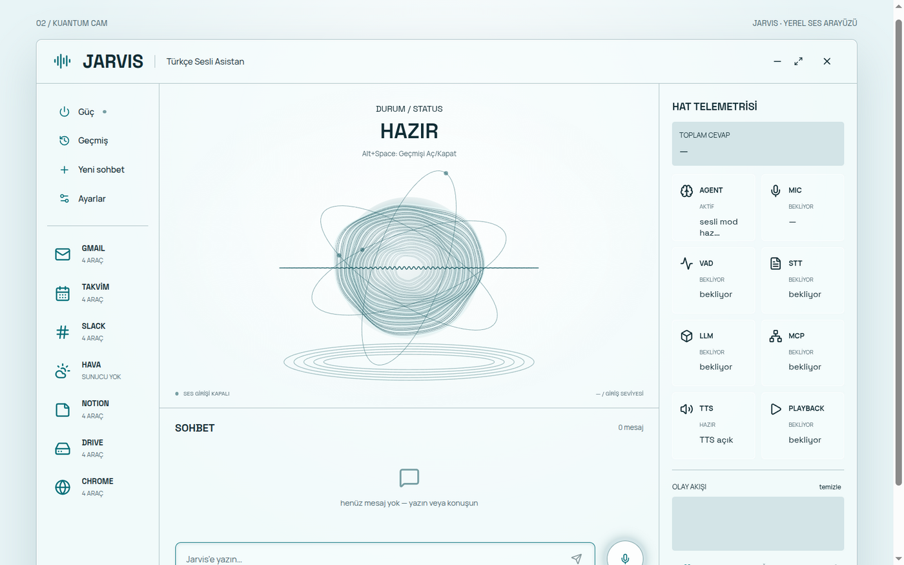
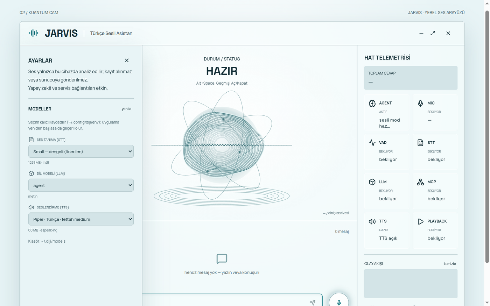
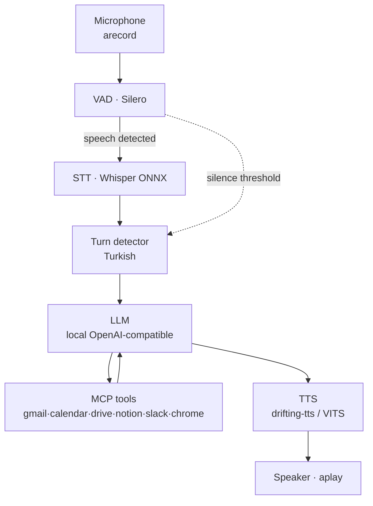

# Diji Voice Assistant

[Türkçe](README.md) · **English**

**A fully local Turkish voice assistant.** No cloud, no telemetry, the audio
never leaves your machine. Speech recognition, speech synthesis, voice activity
detection and every language-model call run locally.

```
Microphone → VAD → Whisper (STT) → Turn detector → LLM → MCP tools → TTS → Speaker
```



<details>
<summary><b>Settings — model selection</b> (click to expand)</summary>



The lists are generated **entirely from what is present on the machine**.
Selections are persisted to `~/.config/diji/env`.

</details>

---

## Table of contents

- [What it does](#what-it-does)
- [Architecture](#architecture)
- [Design decisions](#design-decisions)
- [Requirements](#requirements)
- [Installation](#installation)
- [Running it](#running-it)
- [Desktop UI](#desktop-ui)
- [Control API](#control-api)
- [Model management](#model-management)
- [Configuration](#configuration)
- [Permission gate](#permission-gate)
- [Privacy and security](#privacy-and-security)
- [Project layout](#project-layout)
- [Troubleshooting](#troubleshooting)
- [Commands](#commands)
- [Contributing](#contributing)
- [License](#license)

---

## What it does

| Capability | Technology | Status |
|---|---|---|
| Speech recognition (STT) | sherpa-onnx + Whisper | ✅ Real, verified |
| Voice activity (VAD) | sherpa-onnx + Silero | ✅ Real, verified |
| Speech synthesis (TTS) | Drifting TTS (Python) + sherpa-onnx VITS/Piper fallback | ✅ Real, verified |
| Language model (LLM) | OpenAI-compatible local endpoint (`127.0.0.1:8000`) | ✅ Real, verified |
| Tool use (MCP) | JSON-RPC 2.0 over stdio, 6 servers | ✅ Real, 24 tools |
| Permission gate | 🟢 read / 🟡 write (confirm) / 🔴 delete | ✅ Verified |
| Desktop UI | Electron + TanStack Start (React) | ✅ Builds |
| Model selection | Settings panel for STT/LLM/TTS, **persistent** | ✅ Verified |

**There are no mock responses in the audio path.** If model files are missing,
the engine fails **loudly** — silent faults such as "the assistant talks but
there is no sound" are not tolerated.

---

## Architecture



### Components

| Directory | Responsibility | Language |
|---|---|---|
| [`shared/`](shared) | Types, default configuration, permission gate, logger. The foundation everything depends on. | TS |
| [`agent/`](agent) | Audio pipeline, control server (`127.0.0.1:8899`), telemetry, model catalog. | TS |
| [`mcp_servers/`](mcp_servers) | Six MCP servers (gmail, calendar, drive, notion, slack, chrome) as stdio subprocesses. | TS |
| [`ui-app/`](ui-app) | Electron + TanStack Start desktop UI. Independent build. | TS/TSX |
| [`ui/`](ui) | **Archive** — the previous Next.js UI. New work happens in `ui-app/`. | TS |
| [`scripts/`](scripts) | Model download, diagnostics, E2E verification. | JS/Py/sh |

### Layer dependency rule

```
shared  ←  agent  ←  (nothing)
shared  ←  mcp_servers
ui-app  →  HTTP/SSE  →  agent     (no code dependency, contract only)
```

`shared` may not depend on any workspace. `agent` may not depend on
`mcp_servers` as code (it only spawns them as processes). `ui-app` never imports
agent code — it only uses the `window.diji` bridge.

---

## Design decisions

| Decision | Rationale |
|---|---|
| **16 kHz mono PCM16 everywhere** | STT, VAD and `/inject` all expect the same format. A single differing rate anywhere breaks segmentation and transcription. |
| **Microphone device pinned to `default`** | Switching to a raw hardware device (`plughw:...`) grabs the device exclusively and cuts the microphone for every other application. |
| **`totalMs` = turn start → first audio** | What the user actually waits for. `playbackMs` happens *after* it and is deliberately not part of the sum. |
| **`turnToken` per turn** | A late event from an old turn must not reset the counters of a new one when turns overlap. |
| **`isSpeaking` is derived** | It is true if the `tts` **or** `playback` stage is active. Collapsing it into one boolean leaves the UI stuck on `SPEAKING` after a barge-in. |
| **Barge-in closes all three** | `llm` + `tts` + `playback`. Stopping playback alone leaves the pipeline half-alive. |
| **`current` = the running engine's identity** | If `drifting-tts` fails to start, the engine silently falls back to `sherpa-vits`. Reading `config` instead would be misleading. |
| **Persistence in `~/.config/diji/env`, not `config.json`** | `config.json` resolves against `process.cwd()`, which differs between terminal, Electron and systemd. The env file is absolute and is read before `@diji/shared` is even evaluated. |
| **An invalid selection is never written** | `/models/select` returning `409` must leave the env file untouched — otherwise the agent breaks on next start. |
| **Re-selecting the same model is a no-op** | Measured: a needless engine restart costs 8 s of dead time plus an unnecessary microphone cut. |
| **No credential in the repo** | `*.env`, `credentials*.json`, `token*.json`, `*.pem`, `*.key`, `oauth-tokens/` are all ignored. Model weights are not shipped either. |

---

## Requirements

| Requirement | Note |
|---|---|
| Node.js ≥ 20, npm 10 | The agent is ESM (`"type": "module"`). |
| `alsa-utils` (`arecord`, `aplay`) | Audio I/O. |
| `ffmpeg` (optional) | Only for converting test audio to PCM. |
| `python3` (optional) | Only for the `drifting-tts` backend. |
| A local OpenAI-compatible LLM server | e.g. llama.cpp, Ollama, vLLM, LM Studio on `127.0.0.1:8000`. |
| Model files | `~/.diji/models` — see [docs/en/MODELS.md](docs/en/MODELS.md). |

Linux is the supported platform. The audio layer shells out to
`arecord`/`aplay`.

---

## Installation

```bash
git clone https://github.com/tekinaltun2025/Diji_Voice_Assistant.git
cd Diji_Voice_Assistant

npm install                       # postinstall builds the shared package
./scripts/download-models.sh all  # VAD + Whisper + VITS (~1.5 GB)
npm run build
```

Verify the LLM server before starting:

```bash
curl -s http://127.0.0.1:8000/v1/models | head -c 300
```

If the server is down the agent still starts — the Settings panel simply reports
the model as unavailable rather than pretending it is selectable.

---

## Running it

### 1. Voice mode (the main use case)

```bash
npm start
# equivalent to: node agent/dist/index.js
```

### 2. Text mode (no microphone)

```bash
npm run start:text
# equivalent to: DIJI_MODE=text node agent/dist/index.js
```

### 3. Desktop UI

```bash
cd ui-app
npm install
env -u ELECTRON_RUN_AS_NODE npm run electron:build
```

> **Note** — if `ELECTRON_RUN_AS_NODE=1` is set in your shell (it is in some
> setups), Electron behaves like plain Node and no window appears. Always launch
> with `env -u ELECTRON_RUN_AS_NODE`.

### 4. Everything together

```bash
npm run dev    # agent + UI in watch mode
```

---

## Desktop UI


| Region | Contents |
|---|---|
| **Sidebar** | Navigation: Chat, History, Settings. History and Settings are mutually exclusive. |
| **Controls** | Microphone on/off, TTS on/off, barge-in (interrupt) |
| **Stage** | Audio visualisation plus the current stage readout |
| **Chat** | Conversation transcript and text input |
| **Telemetry** | Eight stages (AGENT, MIC, VAD, STT, LLM, TTS, PLAYBACK, MCP) and a live log |
| **Confirmation dialog** | Visual confirmation, shown alongside the spoken question, for MCP `write`/`delete` |

The renderer runs with `contextIsolation: true`, `nodeIntegration: false` and a
narrow `window.diji` preload surface. It never opens the microphone itself — the
agent is the sole owner of the audio pipeline.

---

## Control API

The agent exposes a small HTTP + SSE server on `127.0.0.1:8899`. The host is a
**constant**; it cannot be bound to `0.0.0.0`.

| Method | Path | Purpose |
|---|---|---|
| `GET` | `/health` | Liveness (`{ ok, pid, uptime }`) |
| `GET` | `/state` | Full snapshot of pipeline, audio, telemetry, conversation |
| `GET` | `/events` | Live SSE stream (`snapshot`, `stage`, `log`, `turn-latency`, `conversation-update`, `confirmation`, `tts-toggle`) |
| `POST` | `/listen` | Enable/disable the microphone |
| `POST` | `/ask` | Text turn, returns `202`; the answer arrives over SSE |
| `POST` | `/inject` | Feed raw PCM16/16 kHz as if it came from the microphone (diagnostics) |
| `POST` | `/tts` | Toggle speech output (`null` → fall back to env) |
| `POST` | `/confirm` | Answer a pending MCP confirmation |
| `POST` | `/bargein` | Interrupt the current turn |
| `GET` | `/models` | Model catalog for the Settings panel |
| `POST` | `/models/select` | Switch model, persist to `~/.config/diji/env` |

Full contracts, field semantics, SSE schemas and error codes:
**[docs/en/API.md](docs/en/API.md)** ([Türkçe](docs/API.md)).

```bash
curl -s http://127.0.0.1:8899/health
curl -s http://127.0.0.1:8899/state | jq '.stages[] | {key, status, detail}'
curl -N http://127.0.0.1:8899/events | head -200
```

---

## Model management

Model files live in `~/.diji/models` (override with `DIJI_MODELS_DIR`). They are
**not** committed — `.gitignore` excludes `*.onnx`, `*.gguf`, `*.pt`, `*.bin`,
`*.safetensors`.

```bash
./scripts/download-models.sh all
./scripts/download-models.sh stt-small   # Whisper small only
./scripts/download-models.sh tts
./scripts/download-models.sh vad
```

The catalog is built purely from disk:

| Kind | Source | Requirement |
|---|---|---|
| STT | `~/.diji/models/sherpa-onnx-whisper-<prefix>/` | `<prefix>-encoder*.onnx`, `<prefix>-decoder*.onnx`, `<prefix>-tokens.txt` — **all three** |
| TTS | `~/.diji/models/vits-*` | any `.onnx` + `tokens.txt` |
| LLM | `http://127.0.0.1:8000/v1/models` | 2.5 s timeout; empty list if the server is down |

A model whose files are incomplete still appears in the list, but greyed out
(`available: false`) with the reason in `detail` — the user should be able to see
*why* something cannot be selected.

Switching costs differ deliberately:

| Kind | What happens | Time |
|---|---|---|
| `llm` | Only the name sent in the next request changes | Instant |
| `stt` | `STTEngine` disposed and recreated | ~2–6 s |
| `tts` (VITS) | `TTSEngine` disposed and recreated | ~1–3 s |
| `tts` (`drifting-tts`) | Python bridge restarts | ~60–70 s → `slow: true` |

Details, measured sizes and third-party licenses:
**[docs/en/MODELS.md](docs/en/MODELS.md)** ([Türkçe](docs/MODELS.md)).

---

## Configuration

Resolution order (highest wins):

```
1. Process environment      (export, systemd, Electron spawn env)
2. ~/.config/diji/env       (persistent user setting — applied only if unset)
3. Built-in defaults        (shared/src/config/default.ts)
```

`~/.config/diji/env` is a plain `KEY=value` file — not a shell script. `#`
comments are preserved, writes are atomic (temp + `rename`), the file mode is
`0600`, and the writer **never throws**.

Full variable reference: **[docs/en/CONFIGURATION.md](docs/en/CONFIGURATION.md)**
([Türkçe](docs/CONFIGURATION.md)). A commented template lives at
[`.env.example`](.env.example).

---

## Permission gate

| Class | Behaviour |
|---|---|
| `read` | Executed immediately (search, list, read) |
| `write` | Requires **voice confirmation** with a one-time token (5 min TTL) |
| `delete` | **Blocked** by default. With `DIJI_ALLOW_DELETE=true` it still requires confirmation on every call. |

The gate protects **you from the LLM**, not the LLM from you: a model that
misreads your intent can initiate a `write`, so read the confirmation dialog
instead of clicking through it.

---

## Privacy and security

| Question | Answer |
|---|---|
| Is audio uploaded? | **No.** Processed in memory only, never written to disk. |
| Is the transcript stored? | **No.** Kept in memory (last 50 messages) and shown in the UI. |
| Does the control server listen on the network? | **No.** `127.0.0.1` is a hardcoded constant. |
| Are credentials in the repo? | **No.** Verified by a secret scan; `*.env`, `*.pem`, `credentials*.json` are ignored. |
| Are model weights in the repo? | **No.** Downloaded separately under their own licenses. |

Threat model, known limitations and a hardening checklist:
**[SECURITY.en.md](SECURITY.en.md)** ([Türkçe](SECURITY.md)).

---

## Project layout

```
Diji_Voice_Assistant/
├── agent/                 # Audio pipeline, control server, telemetry
│   ├── src/pipeline.ts    # Turn lifecycle, model switching, persistence
│   ├── src/model-catalog.ts
│   ├── src/env-bootstrap.ts
│   ├── src/env-prefs.ts
│   └── src/control-server.ts
├── shared/                # Types, defaults, permission gate
├── mcp_servers/           # gmail · calendar · drive · notion · slack · chrome
├── ui-app/                # Electron + TanStack Start desktop UI
├── ui/                    # Archived Next.js UI
├── scripts/               # download-models, smoke-test, cdp-eval, cdp-screenshot
├── docs/
│   ├── ARCHITECTURE.md
│   ├── API.md
│   ├── CONFIGURATION.md
│   ├── MODELS.md
│   └── screenshots/
├── README.md              # Turkish
├── README.md              # Turkish (default)
├── README.en.md           # English (this file)
├── SECURITY.md            # Turkish
├── SECURITY.en.md         # English
├── CONTRIBUTING.md        # Turkish
├── CONTRIBUTING.en.md     # English
└── LICENSE
```

---

## Troubleshooting

| Symptom | Cause | Fix |
|---|---|---|
| "The assistant talks but I hear nothing" | Wrong output device or TTS engine failed to start | `aplay -l`; check `curl -s 127.0.0.1:8899/state \| jq .stages` |
| "It does not hear me" | Wrong input device — the most common cause | `arecord -l`; `DIJI_AUDIO_INPUT_DEVICE`; check `audio.acRms` in `/state` |
| Whisper hallucinates in silence | Whisper invents text in silent regions | Keep `DIJI_STT_TRIM_THRESHOLD` at its default; the preprocessor trims silence |
| Empty LLM replies | Reasoning budget too small for a reasoning model | Raise `DIJI_LLM_REASONING_RESERVE` (default `1024`); `0` for non-reasoning models |
| Model greyed out in Settings | Missing model files | Read the `detail` field; run `download-models.sh` |
| Selection lost after restart | Env file not written | Check `persistError` in the notice; `stat -c '%a' ~/.config/diji/env` → `600` |
| Electron opens no window | `ELECTRON_RUN_AS_NODE=1` in the shell | `env -u ELECTRON_RUN_AS_NODE` |
| `tsc` reports hundreds of errors | `shared` built after `agent` | Always use `npx tsc -b`, which honours project reference order |

---

## Commands

| Command | Purpose |
|---|---|
| `npm start` | Start the agent (voice mode) |
| `npm run start:text` | Text mode, no microphone |
| `npm run dev` | Agent + UI in watch mode |
| `npm run build` | Build all workspaces |
| `npx tsc -b` | Type-check via project references |
| `npm run test:agent` | Unit tests (Jest) |
| `node scripts/smoke-test.js` | End-to-end smoke test |
| `node scripts/smoke-test.js --skip-audio` | Smoke test without an audio device |
| `node scripts/control-e2e.js` | Exercise every control endpoint |
| `node scripts/inject-e2e.js file.pcm` | Inject PCM as if from the microphone |
| `CDP_PORT=9333 node scripts/cdp-eval.js "<js>"` | Query the running UI over CDP |
| `CDP_PORT=9333 node scripts/cdp-screenshot.js out.png` | Capture a screenshot of the running UI |
| `./scripts/download-models.sh all` | Download VAD + STT + TTS models |

---

## Contributing

See **[CONTRIBUTING.en.md](CONTRIBUTING.en.md)** ([Türkçe](CONTRIBUTING.md)) for
build order, testing
layers, coding rules and the non-negotiable invariants. Note that `console.*` is
forbidden inside `agent/`, `shared/` and `mcp_servers/` — use the structured
logger instead.

---

## License

[MIT](LICENSE) © 2026 Tekin Altun.

Model weights, datasets and third-party runtimes are **not** covered by this
license and are not in this repository — see
[docs/en/MODELS.md](docs/en/MODELS.md#licences) for their respective terms.
